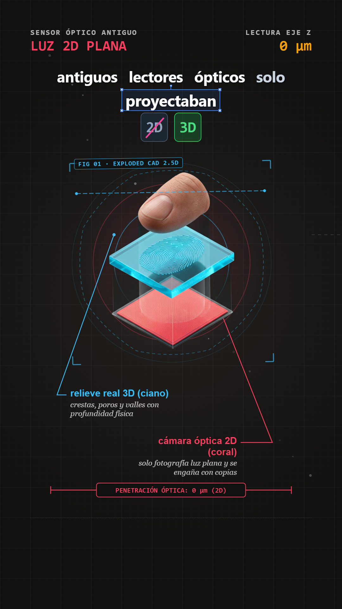
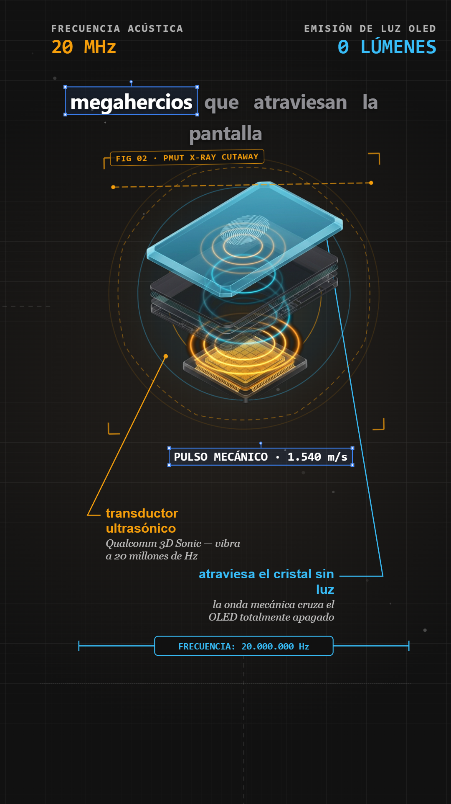
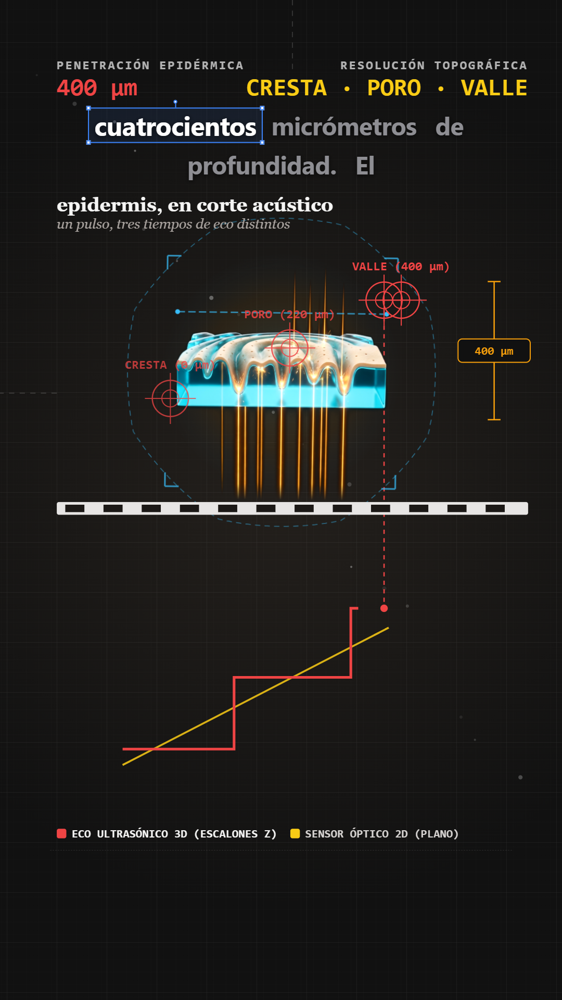
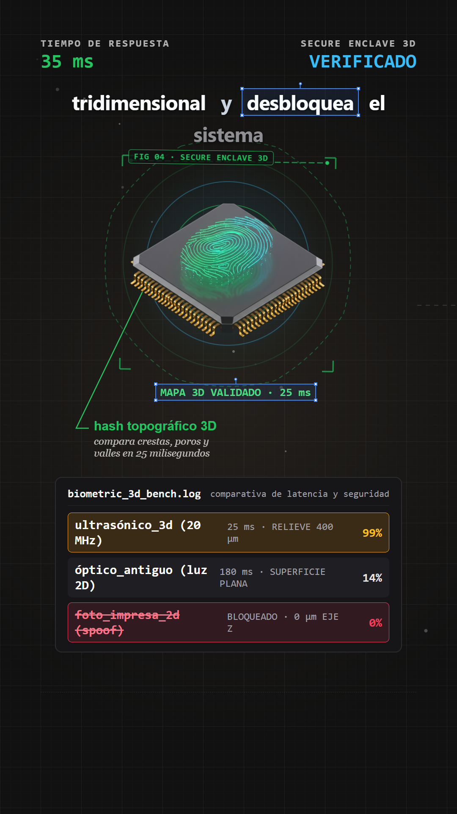
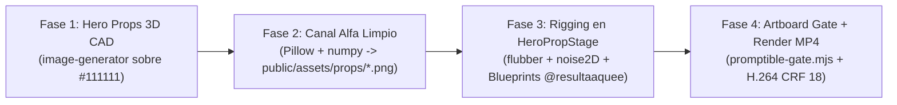

# AutoVideo Studio — Motor Programático `@resultaaquee` + `TrendForge` (Remotion + ElevenLabs)

Estudio de generación programática de vídeos verticales de divulgación científica e ingeniería (**9:16 · 1080×1920 @ 30 fps**) construido sobre **Remotion 4**, **ElevenLabs Audio-First Sync**, el **Pipeline Art-First 3D CAD (`HeroPropStage`)**, los **15 Blueprints de OPENMONTAGE** y las **27 Reglas de Motion Design de LottieFiles**.

---

## Vista Previa — *«Cómo Funciona el Lector de Huellas Ultrasónico 3D»*

| Escena 1 · Vista Explosionada 2.5D | Escena 2 · Corte Rayos X PMUT (20 MHz) | Escena 3 · Cronofotografía + Osciloscopio | Escena 4 · Secure Enclave 3D + Dataset |
| :---: | :---: | :---: | :---: |
|  |  |  |  |

---

## 1. Arquitectura y Procedimiento «Art-First» (4 Fases)

Para lograr un acabado estético de nivel **Keynote Industrial / `@resultaaquee`**, el estudio separa estrictamente **la ilustración física (*«el dibujo»*)** de **la telemetría vectorial en vivo (*«el código»*)**:



1. **Fase 1 — Generación de Hero Props 3D CAD (`image-generator`)**:
   - Se generan ilustraciones isométricas 3D CAD, cortes transversales en modo Rayos X cian/ámbar y secciones macro científicas sobre fondo uniforme `#111111` y **sin texto incrustado**.
2. **Fase 2 — Extracción de Canal Alfa Limpio (`public/assets/props/*.png`)**:
   - Se procesan con Python (`Pillow` + `numpy`) para transformar el fondo `#111111` en transparencia alfa suave con viñeteado radial, integrándose sobre la cuadrícula milimetrada de `BlueprintSurface` sin bordes rectangulares.
3. **Fase 3 — Rigging en `<HeroPropStage />` (`src/components/blueprints/ResultaaqueeBlueprints.tsx`)**:
   - Levitación orgánica determinista en 2.5D con `noise2D` (`@remotion/noise`).
   - Contorno técnico perimetral que muta continuamente entre geometrías CAD mediante `flubber`.
   - Curvas de entrada `SPRING_SNAPPY` + `MOTION_EASING.quartOut` (`LottieFiles/motion-design-skill`), barrido láser de Rayos X (`scanBeam`) y anillos acústicos concéntricos.
   - Anotaciones técnicas conectadas en vivo: `LeaderLineCallout`, `DimensionRuler`, `HypothesisScoreboard`, `TargetReticle`, `LiveTelemetryGraph`, `DatasetTerminalDrawer` y `VectorSelectionBox`.
4. **Fase 4 — Artboard Gate & Critic Gate**:
   - Verificación estática con `npm run typecheck` y `node scripts/promptible-gate.mjs` (16 puntos de control), seguida de previsualización de fotogramas clave (`npx remotion still`) antes de codificar el MP4 final.

---

## 2. Los 5 Modos de Laboratorio Visual (`BLUEPRINT_THEMES`)

Configurados en [`src/theme/motion.ts`](src/theme/motion.ts) y renderizados por `<BlueprintSurface />`:

| Modo (`BlueprintModeId`) | Inspiración `@resultaaquee` | Paleta Principal | Primitivas Clave |
| :--- | :--- | :--- | :--- |
| `BLUEPRINT_BLUE` | *Ref 1 — 1.000 botellas y 10 catadores* | Azul ingeniería `#15457A` + Ocre `#FBBF24` | `CornerHudTelemetry`, cuadrícula milimetrada doble |
| `DARK_CAD_XRAY` | *Ref 2 — Teclado iPhone* & *Ref 3 — Gancho del Metro* | Carbón `#111111` + Cian `#38BDF8` + Ámbar `#F59E0B` | `HeroPropStage`, `ExplodedLayerStack`, `LeaderLineCallout`, `DimensionRuler`, `DatasetTerminalDrawer` |
| `TOPOLOGY_WIREFRAME` | *Ref 4 — Topología de la pajita* | Negro petróleo `#0A0E12` + Verde `#22C55E` + Rosa `#EC4899` | `HypothesisScoreboard` (`[2D̸] [3D]`) |
| `CHRONO_OSCILLOSCOPE` | *Ref 5 — Cronofotografía de las palomas* | Papel carbón `#1E1D1B` + Rojo `#EF4444` + Amarillo `#FACC15` | `TargetReticle`, raíl calibrado, `LiveTelemetryGraph` (`evolvePath`) |
| `EDITORIAL_PAPER` | *Modo Editorial / Hemeroteca* | Papel cálido `#F8F7F4` + Tinta `#141413` | `RoughCard`, citas y recortes históricos |

---

## 3. Sincronización Vocal Audio-First y Subtítulos Sin Vibración (`DynamicCaptions.tsx`)

- **Voz Canónica (`TrendForge`)**: `ELEVENLABS_VOICE_ID = "RwzBDEn5f6FIgpAjH9YN"` (*«Gabriel Blanco — Voz Canónica de Leo»*), modelo `eleven_multilingual_v2`, con normalizador fonético `preprocessForTts` en [`scripts/elevenlabs-sync.mjs`](scripts/elevenlabs-sync.mjs).
- **4 Variantes de Subtítulos (`src/components/DynamicCaptions.tsx`)**:
  - `vector-box`: Ventana progresiva de 5 palabras con marco de selección vectorial azul Figma (`#3B82F6`, 4 nodos blancos de esquina y mástil superior) anclado automáticamente sobre la **palabra clave semántica activa** (ignorando artículos y conectores).
  - `ochre-blueprint`: Texto blanco con palabras clave en amarillo ocre `#FBBF24`.
  - `red-pill`: Ventana compacta de 3 palabras con pastilla roja `#DC2626`.
  - `editorial-clean`: Texto oscuro `#141413` sobre papel técnico `#F8F7F4`.
- **Cero reflujo / cero vibración**: Todas las palabras comparten idéntico `box-model` y retención de `450 ms` en pausas respiratorias.

---

## 4. Stack Técnico y Paquetes de Suavidad

- **Core**: `remotion@4.0.536`, `@remotion/cli`, `react@18`, `typescript`
- **Suavidad, Geometría y 3D**:
  - `flubber` — Morphing continuo entre trazados SVG arbitrarios.
  - `@remotion/noise` — Ruido Perlin 2D/3D determinista por fotograma (`noise2D`).
  - `@remotion/paths` — Evolución e interpolación de curvas vectoriales (`evolvePath`, `interpolatePath`).
  - `@remotion/motion-blur` — Desenfoque de obturador de cámara (`<CameraMotionBlur />`, `<Trail />`).
  - `@remotion/three`, `three`, `@react-three/fiber` — Soporte para escenas WebGL 3D integradas con `useCurrentFrame()`.
  - `d3-delaunay` — Triangulación de Delaunay y diagramas de Voronoi para mapas de impacto.

---

## 5.Estructura del Repositorio

```text
├── .agent/skills/                  # Skills modulares (broll-motion-aesthetic, remotion-video-director, etc.)
├── public/
│   ├── assets/
│   │   ├── previews/               # Capturas del Artboard Gate (scene1-art.png .. scene4-art.png)
│   │   └── props/                  # Hero Props 3D CAD con canal alfa limpio (*.png)
│   └── audio/                      # Locuciones MP3 por escena + manifiesto de tiempos info.json
├── references/
│   └── LESSONS.md                  # Memoria acumulativa del Critic Gate
├── scripts/
│   ├── elevenlabs-sync.mjs         # Generador TTS ElevenLabs con timestamps carácter/palabra
│   └── promptible-gate.mjs         # Auditor estático de 16 reglas (Zero CSS transition, clamp, etc.)
├── src/
│   ├── components/
│   │   ├── blueprints/
│   │   │   └── ResultaaqueeBlueprints.tsx  # 10 primitivas @resultaaquee + HeroPropStage
│   │   ├── CameraRig.tsx           # Lienzo continuo 2D + SPRING_CAMERA + rackFocusBlur
│   │   └── DynamicCaptions.tsx     # Subtítulos palabra por palabra sin vibración
│   ├── data/
│   │   ├── schema.ts               # Esquemas Zod de escenas y telemetría
│   │   └── scenes.json             # Guion técnico sincronizado
│   ├── scenes/
│   │   ├── Scene1.tsx              # Escena 1: Dedo 3D vs Sensor Óptico 2D
│   │   ├── Scene2.tsx              # Escena 2: Corte Rayos X Transductor PMUT (20 MHz)
│   │   ├── Scene3.tsx              # Escena 3: Epidermis Macro (400 µm) + Osciloscopio
│   │   └── Scene4.tsx              # Escena 4: Chip Secure Enclave 3D + Dataset Drawer
│   ├── theme/
│   │   └── motion.ts               # Físicas SPRING_SNAPPY/SPRING_CAMERA, 15 Blueprints y 27 Reglas
│   ├── Root.tsx                    # Cálculo dinámico del Frame Budget desde info.json
│   └── Video.tsx                   # Timeline maestro Audio-First
└── AGENTS.md                       # Constitución técnica y protocolo multiagente de 5 Slots
```

---

## 6. Uso Rápido

### 1. Instalar dependencias
```bash
npm install
```

### 2. Sincronizar locución y timestamps con ElevenLabs (Audio-First)
Configura `ELEVENLABS_API_KEY` en tu archivo `.env` y ejecuta:
```bash
npm run sync-audio
```

### 3. Ejecutar validación de tipos y el Critic Gate (16 puntos)
```bash
npm run typecheck
node scripts/promptible-gate.mjs
```

### 4. Abrir el estudio interactivo o renderizar el MP4 final
```bash
# Vista previa en vivo (http://localhost:3000)
npm run studio

# Renderizar fotogramas del Artboard Gate
npx remotion still src/index.ts MainVideo public/assets/previews/scene1-art.png --frame=135

# Renderizar vídeo completo en alta calidad (H.264 CRF 18)
npx remotion render src/index.ts MainVideo out/final.mp4 --codec=h264 --crf=18
```
