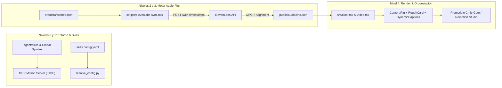

# Implementation Plan: Estudio de Vídeo Programático Vectorial (Remotion + ElevenLabs)

Este plan detalla el despliegue completo y no interactivo (Niveles 0 a 4) del estudio de producción de vídeo programático basado en **Remotion** y sincronizado audio-first con **ElevenLabs**.

---

## Arquitectura General del Sistema

---

## Fases de Ejecución

### Fase 1: Nivel 0 — Unificación de Directorios Globales/Locales y MCP
- Crear directorios `~/.agents/skills` y `~/.gemini/antigravity`, vinculando `~/.gemini/antigravity/skills` hacia `~/.agents/skills` (compatible con Windows mediante Junction/Symlink y soporte POSIX).
- Crear `.agent/skills/` en el workspace local.
- Configurar `.agents/mcp_config.json` para el servidor MCP `@ahmeterdempmk/mcp-motion` en `localhost:3030`.
- Inicializar `references/LESSONS.md` con plantilla estructurada de memoria persistente para auditorías post-render.

### Fase 2: Nivel 1 — Escalado No Interactivo y Descarga de Skills
- Generar programáticamente `package.json`, `tsconfig.json`, `postcss.config.mjs` y `remotion.config.ts` con soporte TypeScript y TailwindCSS.
- Instalar de forma no interactiva:
  - **Core y Vectores**: `remotion`, `@remotion/cli`, `@remotion/transitions`, `@remotion/shapes`, `lucide-react`, `roughjs`, `zod`, `dotenv`, `@remotion/tailwind-v4` / `tailwindcss`.
  - **Audio y Subtítulos ElevenLabs**: `@remotion/captions`, `@remotion/elevenlabs`, `@remotion/media-utils`.
- Descargar e instalar las 4 familias de Agent Skills:
  1. `remotion-dev/skills`
  2. `liamrjohnston/remotion-motion-graphics-skill`
  3. `BayramAnnakov/remotion-video-director` en `.agent/skills/remotion-video-director/SKILL.md`
  4. `Maartenlouis/elevenlabs-remotion-skill` en `.agent/skills/elevenlabs-remotion/SKILL.md`

### Fase 3: Nivel 2 — Arquitectura de Directorios y Sistema de Movimiento
- Construir la jerarquía completa de directorios (`public/audio`, `public/assets`, `scripts/`, `src/components`, `src/data`, `src/scenes`, `src/theme`).
- Implementar `.agent/skills.config.yaml` y `scripts/resolve_config.py` (FPS: `30`, Resolución: `1080x1920`, Superficie: `#F8F7F4`, `voice_id`, `model_id`).
- Codificar `src/theme/motion.ts` y `AGENTS.md` con las reglas inquebrantables:
  - **Sistema de Movimiento Cerrado**: Solo `useCurrentFrame()` e `interpolate()` con `{ extrapolateLeft: "clamp", extrapolateRight: "clamp" }`.
  - **Físicas `spring()` únicas**:
    - `SPRING_SNAPPY = { damping: 20, stiffness: 200, mass: 0.8 }`
    - `SPRING_CAMERA = { damping: 30, stiffness: 90, mass: 1.2 }`
  - **Política Zero-Neon**: Superficie cálida `#F8F7F4`, sin resplandores ni estética cyberpunk.
  - **Zona Segura Vertical (9:16)**: Elementos clave en el 85% superior (reserva inferior de 288px), titulares $\ge 64\text{px}$ ($\le 7$ palabras), etiquetas $\ge 28\text{px}$ ($\le 20$ palabras), padding lateral $\ge 96\text{px}$.
  - **Regla de Locución**: Prohibido duplicar literalmente la locución en el texto gráfico de pantalla.

### Fase 4: Motor Exclusivo ElevenLabs y Sincronización Audio-First
- Programar `scripts/elevenlabs-sync.mjs`:
  - Lectura de `.env` y `src/data/scenes.json`.
  - Mapeo de presets (`narrator`, `expert`, `dramatic`, `conversational`, `calm`).
  - Petición a `https://api.elevenlabs.io/v1/text-to-speech/${voiceId}/with-timestamps?output_format=mp3_44100_128` con *Request Stitching* (`previous_text`, `next_text`, `previous_request_ids`).
  - Decodificación de `audio_base64` a `public/audio/${scene.id}.mp3`.
  - Conversión de `alignment` de caracteres a `wordTimestamps` (`{ word, startMs, endMs, startFrame, endFrame }`).
  - Auditoría con `ffprobe` para medir `actualDuration`, ritmo de habla ($2.0 - 4.5$ palabras/s) y silencios inicial/final (`leadingSilence > 200ms`, `trailingSilence > 500ms`).
  - Generación de `public/audio/info.json` (incluyendo estado inicial de diagnóstico válido para compilación en espera).
- Programar `scripts/promptible-gate.mjs` para verificación automatizada del Critic Gate y estructura.
- Configurar `src/Root.tsx` y `src/Video.tsx` leyendo `public/audio/info.json` con transiciones cross-dissolve (`8-12` fotogramas), `<Audio />` por escena y soporte de pista musical con *audio ducking* automático.

### Fase 5: Nivel 3 y 4 — Protocolo Multiagente (5 Slots) en `AGENTS.md`
- Documentar en `AGENTS.md` la matriz de aislamiento de escritura por Slots (`SLOT 1: research`, `SLOT 2: video-director`, `SLOT 3: self Builder Impar`, `SLOT 4: self Builder Par`, `SLOT 5: browser Critic Gate`).

### Fase 6: Verificación y Arranque en Espera
- Auditar encabezados YAML de todas las skills instaladas en `.agent/skills/` y `~/.gemini/antigravity/skills/`.
- Crear `.env.example` con `ELEVENLABS_API_KEY=tu_api_key_aqui` y `ELEVENLABS_VOICE_ID=JBFqnCBsd6RMkjVDRZzb`.
- Validar compilación TypeScript (`npx tsc --noEmit`) y levantar `npm run dev` en `http://localhost:3000` sin errores.
- Presentar el resumen de verificación y quedar en espera del primer guion y credenciales `.env`.
